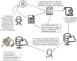

# DataBUS: SISAL Data Upload

<!-- badges: start -->

[](https://www.tidyverse.org/lifecycle/#active) [](https://www.nsf.gov/awardsearch/showAward?AWD_ID=1948926) [](https://www.nsf.gov/awardsearch/showAward?AWD_ID=2410961)

[](https://doi.org/10.5281/zenodo.18353609)

<!-- badges: end -->

This repository uses [DataBUS](https://github.com/NeotomaDB/DataBUS), the Neotoma Data Bulk Upload System, to load [SISAL](https://doi.org/10.5194/essd-12-2579-2020) speleothem records into the Neotoma Paleoecology Database.

It was first used for the SISAL v3 load (about 892 entities) and will be also used for the rolling submission of new SISAL entities.

Each SISAL entity is one CSV file. A file goes through three steps:

1. **Clean**: `src/clean_data_all.py` turns a raw SISAL export into a file that matches the template.
2. **Validate**: `src/template_validate.py` checks every field against the Neotoma database and writes a log. Nothing is saved to the database.
3. **Upload**: the same script, run with `--upload True`, saves the records, but only if every check passed.



## Setup

You need [uv](https://docs.astral.sh/uv/) and access to a Neotoma Postgres database.

```bash
uv sync
```

This installs Python 3.11.10 and the dependencies, including DataBUS from GitHub (see `pyproject.toml` for exact branch - you can point to a specific release or branch.).

To pick up new DataBUS commits, run `uv lock --upgrade-package databus` and then `uv sync`.

Create a `.env` file in the repository root. `PGDB_TANK` holds the database connection as JSON, using the keyword arguments of `psycopg2.connect`:

```bash
PGDB_TANK='{"host": "...", "port": 1234, "database": "...", "user": "...", "password": "..."}'
```

**Never commit this file.**

## Folder layout

| Path | What it holds |
|---|---|
| `data/` | Cleaned CSV files waiting to be validated. `template_validate.py` reads every `*.csv` here. |
| `data/original/` | The raw files, moved here by the cleaning step. They are never edited. Do not commit. |
| `data/validation_logs/` | One `.valid.log` per file that passed validation. |
| `data/not_validated_files/` | Files that failed validation, moved out of `data/`. Their logs are in `data/validation_logs/not_validated/`. |
| `src/templates/template.yml` | The crosswalk between SISAL columns and Neotoma tables. |
| `src/unitList_SISALv3.xlsx` | The units attached to each SISAL variable during cleaning. |
| `src/clean_data_all.py` | The cleaning script (the only one to edit). |
| `src/clean_data*.py` | Older scripts kept as a record of the v3 load. Do not edit or run them. |

Everything in `data/` is ignored by git, apart from `data/sisal_entity_5.csv`, which is kept as a small example.

## Step 1: Clean

Put the raw SISAL export in `data/` and run:

```bash
uv run python src/clean_data_all.py 'data/*.csv'
```

For each file, the raw copy is moved to `data/original/` and the cleaned file is written to `data/` under the same name. A file that already has a copy in `data/original/` is skipped, so running the script twice never cleans a file twice.

The cleaning step:

* turns contacts into `Last, First` form and fixes known name problems;
* adds a `_units` column for every variable in the unit list;
* turns age uncertainties into age bounds (age plus the positive uncertainty, age minus the negative one). When an uncertainty is missing, the bound is the age itself, so a chronology without uncertainties still gets bounds;
* adds `sisal_entity_id`, `sisal_site_id` and `collunit_notes`;
* adds `geochron_type` from `date_type`. U/Th methods become `Uranium series`, `C14` becomes `Carbon-14`, `Multiple methods` stays as it is, and everything else becomes `Other`;
* for the newer v4-style exports, collapses the repeated column blocks and merges site notes.

## Step 2: Validate

```bash
uv run python src/template_validate.py --template src/templates/template.yml
```

The script validates each CSV in `data/` against the database, one section at a time (sites, collection units, chronologies, samples, geochronology, contacts, publications and so on). Everything runs inside a transaction that is rolled back, so validation never changes the database.

Each file gets a log. The first line is an [md5 hash](https://en.wikipedia.org/wiki/MD5) of the CSV, used to skip files that have not changed since their last validation. Each section reports `Valid: True` or `Valid: False`, with these markers:

* **✔** the check passed;
* **?** something worth a look, but not an error;
* **✗** the check failed and the file needs a change.

A file with any failed section is moved to `data/not_validated_files/`. Read its log in `data/validation_logs/not_validated/`, fix the problem (in the data, the template, or the cleaning script), put the file back in `data/` and run again.

**Test runs.** Because failing files are moved, run experiments from a scratch folder so the real `data/` is left alone. Copy the CSV into `scratch/data/` and run the script from `scratch/` with `uv run --project <this repository>`.

## Step 3: Upload

Once a file validates cleanly, delete its log, then run the same command with the upload flag:

```bash
rm data/validation_logs/sisal_entity_5.csv.valid.log
uv run python src/template_validate.py --template src/templates/template.yml --upload True
```

The log has to go first because of the hash check described above: a file whose hash matches a log with no errors is treated as already validated and is skipped, even with `--upload True`. Deleting the log makes the script validate the file again.

The records are saved only if every section passed. Otherwise the transaction is rolled back and the log says the data must be fully validated first. The log records the IDs created.

## The template

`src/templates/template.yml` links each CSV column to a Neotoma table and column. A typical entry looks like this:

```yaml
- column: entity_name
  neotoma: ndb.collectionunits.handle
  notes: name by author
  required: false
  rowwise: false
  type: string
```

* `column`: the column in the CSV.
* `neotoma`: the Neotoma table and column it feeds.
* `notes`: a free-text comment for people reading the template.
* `required`: whether the file is invalid without it.
* `rowwise`: `true` when the value changes from row to row, `false` when it repeats down the column.
* `type`: the expected type (`string`, `int`, `float`, `date`).
* `vocab`: an optional list of allowed values.
* `chronologyname`: groups age columns into a named chronology (for example `Bchron_SISAL`).
* `value`: a constant used for every record, such as the dataset type.

A list of Neotoma tables and columns is in the [Neotoma manual](https://open.neotomadb.org/manual) and the [online database schema](https://open.neotomadb.org/dbschema).

## Known issues

* A new Neotoma vocabulary term, such as a facies type or a taxon, must exist in the database before a file that uses it can validate.
* `template_validate.py` moves every CSV that fails, including CSVs in `data/` that are not entity files.
